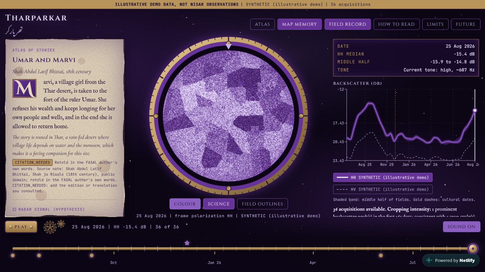

<div align="center">

# FASAL (فصل) — The Indus, as Radar Hears It

**Interactive NISAR radar atlas of Pakistan's Indus plains: backscatter time series become a scrubbable image, a chart and a generated tone, with regional stories, cultural dates and a printable Field Record for each site.**


[](https://www.earthdata.nasa.gov/data/platforms/space-based-platforms/nisar)


**[Live Application](https://YOUR-SITE.netlify.app) · [Pipeline Guide](pipeline/00_README.md) · [References](REFERENCES.md) · [Report a bug](../../issues)**

━━━━━━━━━━━━━━━━━━━━ ✦ ━━━━━━━━━━━━━━━━━━━━

</div>

## 🛰️ At a Glance

- **Real NISAR on the hero site**: Punjab runs on NISAR GCOV acquisitions; Larkana and Tharparkar remain labelled illustrative demo data
- **Honest by design**: whether data is real or demo is a field in the data files (`data_mode`). The banner, the frame stamps and the Field Record label all read it; nothing is hard-coded in the interface
- **NISAR-first pipeline**: ASF search, resumable download, HDF5 inspection and per-field extraction, with no assumed file layout (paths live in `config.yaml` and are confirmed with an inspector script)
- **Gated analysis**: cropping intensity is estimated only with at least 20 acquisitions spanning at least 365 days; otherwise the app says so
- **Radar made audible**: backscatter drives a live Web Audio tone, with a visible text equivalent for accessibility
- **Local context**: Urdu labels, folk tales retold in original words, and cultural dates, each with a source field
- **Printable Field Record** for every site, carrying the same data-mode label as the app
- **No external assets**: all graphics are SVG and canvas, all sound is generated live, and the build is fully static

<br/>

## 🛰️ Overview

In rice-wheat farming regions, food output depends on cropping intensity (one crop or two per year) and on the timing between crops, yet many smallholder communities have no independent record of either. L-band SAR sees through monsoon cloud, day or night, and responds to flooding, surface roughness and vegetation structure, so it can reveal the seasonal rhythm of fields when optical satellites cannot.

FASAL turns radar backscatter time series into a cinematic, interactive experience built for scientists, educators and the public. A time scrubber moves the radar frame, a backscatter chart and a tone together. Cultural dates and detected radar signals share the same timeline. Each site ends in a one-page Field Record a community could keep.

Built solo by **Team Sitaara** for the 2026 NASA Space Apps Challenge, **"Dancing with the SARs"** (NISAR, Earth Science).

<br/>

<div align="center"></div>

<br/>

<div align="center">━━━━━━━━━━━━━━ ✦ ✧ ✦ ━━━━━━━━━━━━━━</div>

<br/>

## 🛰️ Data Status

| Mode | Source | Where it is labelled |
|---|---|---|
| **DEMO** | Synthetic series and frames from `pipeline/07_make_demo_data.py` | Permanent banner, diagonal stamp on every frame, Field Record band and watermark |
| **REAL** | NISAR GCOV files from the ASF DAAC, via `pipeline/01` to `06` | Sensor name in the legend, gauge and Field Record; "N acquisitions available" |
| **MIXED** | Some sites real, some demo | Banner states mixed; each site shows its own mode and sensor |

> **Current build:** **Punjab uses real NISAR L2 GCOV data.** **Larkana and Tharparkar use illustrative demo data**, labelled "ILLUSTRATIVE DEMO DATA, NOT NISAR OBSERVATIONS". The app reports the overall mode as **mixed** and shows each site's own mode and sensor. Demo results illustrate the method only and describe no real field.

<br/>

## 🛰️ How FASAL Addresses the Challenge

| Criterion | What the project does |
|---|---|
| **Impact** | A prototype for how repeat L-band records could give smallholder communities, extension services and educators an independent record of when fields flood, grow and are cleared. The Field Record is something a community can keep. Offered as a future direction, with no yield or food-security claims |
| **Creativity** | An astro-cartographic "antique observatory" interface drawn entirely in code; sonification of backscatter ("Earth's Choir"); folk tales and a festival calendar on the radar timeline; a historical-map swipe |
| **Validity** | Transparent rules in code and in a "How to read this" panel; every interpretation phrased as a hypothesis; the acquisition count always shown; cropping intensity gated by data length; a Limits panel; `CITATION_NEEDED` markers wherever a source is owed; no HDF5 layout assumed; real and demo sites are labelled separately in the same app |
| **Relevance** | NASA-ISRO NISAR L2 GCOV backscatter from the ASF DAAC is the core data on the hero site (per-field dB, polarization comparison, time series). Two further sites carry labelled demo data that exercise the same pipeline and interface |
| **Presentation** | A cinematic opening, a guided atlas, print-ready Field Records, keyboard and screen-reader support, reduced-motion support, plus a 7-slide deck and a 30-second video script in the repo |

<br/>

## 🛰️ Sites

| Site | Landscape | Story | Cultural marker | Role |
|---|---|---|---|---|
| **Central Punjab** (near Kala Shah Kaku / Sheikhupura) | Irrigated rice-wheat belt | Heer and Ranjha (Waris Shah, 1766) | Baisakhi | Hero site; **real NISAR data (N acquisitions)** |
| **Larkana and Mohenjo-daro**, Sindh | Irrigated rice on the Indus | Sassui and Punhun (Bhittai) | Sindhi Culture Day | Shifting-river history; Map Memory site |
| **Tharparkar**, Sindh | Rain-fed desert farming | Umar and Marvi (Bhittai) | Sindhi Culture Day | Monsoon-dependent contrast |


<br/>

## 🛰️ Experience

| Scene | What it does |
|---|---|
| **Opening** | Engraved globe, armillary rings and a radar sweep over the Indus basin, then a camera move to Pakistan. Skippable and reduced-motion aware |
| **Atlas** | Pakistan with three pulsing pins; a cartouche shows each site's data mode and acquisition count |
| **Site View** | Radar frame in a brass porthole, time scrubber with event markers, backscatter chart with interquartile band, story and event cards, polarization and colour/science toggles, playback with sound |
| **Map Memory** | Keyboard-operable swipe between a public-domain historical map and the radar frame; empty state with instructions until a verified map is added |
| **Field Record** | One-page, print-ready summary: chart, detected signals, cultural calendar, cropping-intensity result or "insufficient dates", limits and credits |
| **Drawers** | "How to read this", "Limits" and "Future of NISAR + FASAL" |

<div align="center">

&nbsp;

</div>

<br/>

## 🛰️ Science Logic

Backscatter is read per polarization in dB. For each sample polygon the pipeline takes the mean in **linear power**, converts to dB, then reports the **median across polygons** with a 25th to 75th percentile band. A 3-point moving median and a Savitzky-Golay filter (window 5, order 2) smooth the median series before simple rules run. All thresholds live in `pipeline/config.yaml`.

| Hint | Rule | Reading (a hypothesis, never ground truth) |
|---|---|---|
| Sustained low backscatter | Lowest quarter of the series range for 2 or more acquisitions in June to September | Consistent with standing water or a smooth bare surface |
| Rise | Climbs 1 dB or more above the preceding minimum and stays up | Consistent with canopy growth or field preparation |
| Maximum | Peak with at least 2 dB prominence | Consistent with a canopy near full development |
| Abrupt fall | Drop of 3 dB or more within two acquisitions after a peak | Consistent with harvest or field clearing |
| Fall-to-rise gap | Days from a fall to the next rise | Possible harvest-to-sowing turnaround; agronomic framing is `CITATION_NEEDED` |

**Cropping intensity** counts prominent peaks in the first 365 days, and **only** when the series has at least 20 acquisitions covering at least 365 days. Otherwise the app and the Field Record state "Insufficient dates for cropping-intensity estimate."

<br/>

## 🛰️ Engineering Highlights

- **One source of truth for labels**: the demo banner, frame stamps and Field Record band are generated from `data_mode` and `source` in the JSON, so a site cannot silently change status
- **Config-driven HDF5 extraction**: `03_inspect_h5.py` prints the real file tree and suggests config values; `04` stops with a precise message if a path is wrong
- **Resumable downloader**: size confirmation, dry run, per-run GB cap and `Range` resume of partial files
- **Comparable frames**: one percentile stretch per site across all dates; grayscale for science and a violet ramp stored as quantised palette PNGs for small files
- **Sonification**: pitch maps exponentially from 110 Hz (lowest backscatter) to 880 Hz (highest), through sine and triangle oscillators, a low-pass filter whose cutoff follows the value, a generated reverb impulse and a low tick per time step. Starts only after a user gesture
- **Resilient front end**: lazy-loaded scenes, prefetch of the previous and next frame only, an error boundary, and graceful fallbacks when any JSON or map file is missing
- **Static by design**: no backend, relative base path, deployable to any static host
- **Accessible**: keyboard-operable slider and swipe with `aria-valuetext`, visible focus rings, a text equivalent for the tone, and `prefers-reduced-motion` respected across canvas, CSS and animation

<br/>

## 🛰️ Tech Stack

| Layer | Tools |
|---|---|
| Application | React 18, TypeScript (strict), Vite |
| State | Zustand |
| Globe and mapping | d3-geo (orthographic canvas globe), topojson-client, world-atlas |
| Charts | Recharts (SVG, prints cleanly) |
| Motion | Framer Motion, CSS animation, Canvas 2D |
| Audio | Web Audio API (oscillators, biquad filter, convolver) |
| Typography | Fontsource, self-hosted: Cinzel, Cinzel Decorative, IM Fell English, Cormorant Garamond, JetBrains Mono, Noto Nastaliq Urdu |
| Pipeline | Python 3.10+, asf_search, h5py, NumPy, SciPy, pandas, pyproj, Pillow, PyYAML, tqdm |
| Data | NASA-ISRO NISAR L2 GCOV, distributed by the ASF DAAC |
| Hosting | GitHub, Netlify (static, auto-deploy) |

<br/>

## 🛰️ Data Pipeline

| Script | Purpose |
|---|---|
| `00_README.md` | Earthdata Login (token or `.netrc`), setup, run order, manual ASF Vertex fallback |
| `01_search_nisar.py` | Search ASF for NISAR granules over each site box; writes `granules_<site>.csv` |
| `02_download.py` | Download with size prompt, resume, GB cap and dry run |
| `03_inspect_h5.py` | Print the HDF5 tree, candidate rasters, coordinates and suggested config |
| `04_extract_timeseries.py` | Per-polygon backscatter in dB into `series.json`, with N acquisitions |
| `05_make_frames.py` | Crop and stretch to PNG frames, grayscale and violet, plus `frames.json` |
| `06_derive_events.py` | Rule-based signals, gap metrics, gated cropping intensity, cultural events |
| `07_make_demo_data.py` | Synthetic data for all sites, stamped and labelled as demo |
| `08_build_manifest.py` | Validate every JSON file and write `manifest.json`; reports real, demo or mixed |

<br/>

## 🛰️ Project Structure

```
fasal/
├── pipeline/            # offline Python: search, download, inspect, extract, frames, events, demo, manifest
│   ├── config.yaml      # HDF5 paths and analysis thresholds
│   ├── sites.json       # site boxes, starter polygons, cultural dates
│   └── fields/          # optional hand-drawn polygons (override sites.json)
├── public/
│   ├── data/<site>/     # series, events, frames, analysis, fields (generated)
│   └── maps/            # optional historical maps + maps.json
├── src/
│   ├── scenes/          # Opening, Atlas, SiteView, MapMemory, FieldRecord
│   ├── components/      # globe, scrubber, chart, cards, drawers, decorative SVG
│   ├── lib/             # data loading, audio, phenology, formatting
│   ├── store/           # Zustand store
│   └── styles/          # theme, site, map, record, print
├── assets/              # README screenshots
├── slides/              # 7-slide outline with speaker notes
├── video/               # 30-second video shot list
├── REFERENCES.md
└── LICENSE
```

<br/>

## 🛰️ Getting Started

Runs in DEMO mode with no downloads:

```bash
git clone https://github.com/ktariqq/fasal.git
cd fasal

python -m venv .venv && source .venv/bin/activate   # Windows: .venv\Scripts\Activate.ps1
pip install numpy scipy pillow pyyaml
python pipeline/07_make_demo_data.py
python pipeline/08_build_manifest.py

npm install
npm run dev        # development server
npm run build      # static site in dist/
```

<br/>

## 🛰️ Using Real NISAR Data

```bash
pip install asf_search h5py pyproj pandas tqdm
python pipeline/01_search_nisar.py --sites punjab
python pipeline/02_download.py --sites punjab --dry-run
python pipeline/02_download.py --sites punjab --limit 6
python pipeline/03_inspect_h5.py pipeline/out/data/punjab/<file>.h5
# edit the h5 section of pipeline/config.yaml from what 03 printed
python pipeline/04_extract_timeseries.py --sites punjab
python pipeline/05_make_frames.py --sites punjab
python pipeline/06_derive_events.py --sites punjab
python pipeline/08_build_manifest.py
```
Punjab was produced with exactly these steps; its HDF5 paths in `config.yaml` were confirmed with `03_inspect_h5.py` on the downloaded files. If you run another site, confirm its paths the same way. If few acquisitions exist, the app says "N acquisitions available" and omits cropping intensity. Full steps, authentication and a troubleshooting guide are in [`pipeline/00_README.md`](pipeline/00_README.md). A site becomes REAL only when its `series.json` says `"data_mode": "real"`.

<br/>

## 🛰️ Add a Historical Map

Drop a verified public-domain image at `public/maps/<site>.jpg` and fill in its entry in `public/maps/maps.json` (`title`, `year`, `source_url`, `license`, `verified`). Suggested places to search: Library of Congress, David Rumsey Map Collection, Wikimedia Commons and the British Library. Verify each license yourself. Until a map is added, Map Memory shows an "Add a public-domain map" panel.

<br/>

## 🛰️ Limitations

- **Revisit gaps**: short events can fall between acquisitions
- **Speckle**: averaging inside a field reduces it but does not remove it
- **Confounds**: incidence angle and soil moisture change backscatter without any change in the crop
- **No ground truth**: nothing is validated against field observations
- **Small samples**: four polygons per site cannot represent a region
- **Interpretation**: every reading is a hypothesis, not a measurement of what grew
- **Short real archive**: the Punjab series covers limited acquisitions; seasonal patterns beyond the window cannot be judged

<br/>

## 🛰️ Future Directions

Directions, not claims: more sites and years, comparison with field observations, testing which polarizations best separate flooding, growth and harvest, and extending the Field Record into a simple per-community yearly record. Food-security figures are deliberately omitted until they can be cited.

<br/>

## 🛰️ Deployment

Static build, auto-deployed from `main` on **Netlify**: build command `npm run build`, publish directory `dist`. The relative base path (`./`) also works on GitHub Pages, Vercel, Cloudflare Pages and any file host. Generated demo data in `public/data/` is committed so the deployed site runs with no pipeline step.

<br/>

## 🛰️ AI Assistance

Developed with assistance from Claude (Anthropic) for ideation, research, data-analysis design, and drafting and debugging code and text, including the web app, the Python pipeline and the synthetic demo-data generator. The author reviewed, tested and edited the result. The demo data is synthetic and labelled as such. No image- or audio-generation tools were used, and no NASA logos or branding appear.

<br/>

## 🛰️ References

NISAR, ASF DAAC, every library and font, the story sources and the open items are listed in [`REFERENCES.md`](REFERENCES.md).

<br/>
<br/>

<div align="center">

━━━━━━━━━━━━━━ ✦ ✧ ✦ ━━━━━━━━━━━━━━

Built by **Kommal Tariq** · NASA Space Apps Challenge 2026 · "Dancing with the SARs"

Released under the MIT License. Copyright © 2026 Kommal Tariq.

</div>
